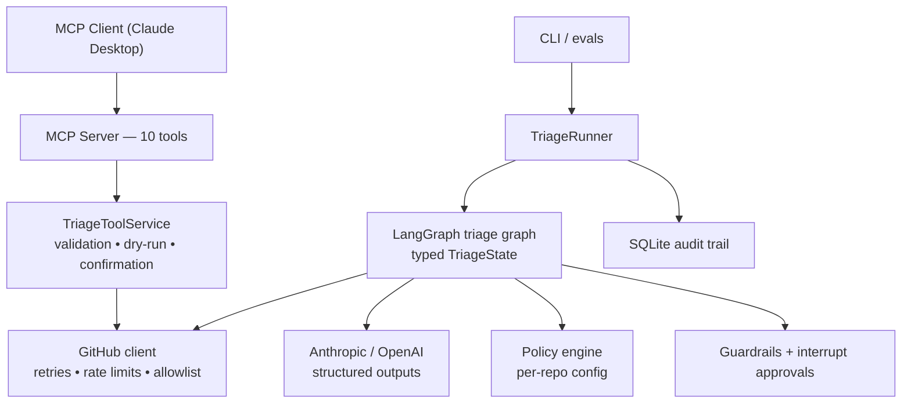

# GitHub Triage Agent

[](https://github.com/umeshmynampati3-cmd/github-triage-agent/actions/workflows/ci.yml)

An autonomous GitHub issue & pull-request triage agent: a **LangGraph** state
machine that classifies, deduplicates, prioritizes and acts on repository
traffic, exposed to any MCP client (Claude Desktop, IDEs) through a
**Model Context Protocol** server — with a hard human-in-the-loop safety
layer, per-repository customer policies, a full audit trail, and a
36-scenario evaluation harness gating it all in CI.

```
Analyzing acme/backend#42… (DRY RUN)
Type: Issue
Classification: bug   Confidence: 93%
Severity: high   Priority: high
Possible duplicate: #7 — "OAuth callback crashes when token expires" (confidence 96%, similarity 0.82)

Actions:
  ◦ Add labels: bug, P1 — would add labels ['bug', 'P1']

Held for human approval:
  ⚠ Post comment (214 chars) — Explains the duplicate verdict before closing as duplicate of #7.
  ⚠ Close as not_planned — Likely duplicate of #7 with 96% confidence.

Escalated: close_issue is destructive and requires confirmation
```

## 1. Problem

Maintainers spend hours a week on repetitive triage: classifying reports,
hunting duplicates, chasing missing reproduction info, mapping components to
owners, nudging PRs without tests. An LLM can do the judgment; the hard part
is doing it *safely* — no hallucinated assignees, no silently closed issues,
no actions a repository's maintainers didn't opt into. This project treats
that as an engineering problem, not a prompting problem.

## 2. Demo

```bash
# dry-run: full reasoning, zero GitHub mutations
triage-agent run --repo you/triage-demo --issue 2 --dry-run

# live, with interactive approval for anything sensitive
triage-agent run --repo you/triage-demo --issue 2 --live
```

[`docs/DEMO_REPOSITORY.md`](docs/DEMO_REPOSITORY.md) seeds a demo repository
with six issues and three PRs (valid bug, duplicate, feature request,
missing-repro, docs request, security report, PR w/o tests, failing CI) so
the whole system can be shown end-to-end without touching a real project.

## 3. Architecture



Full detail, including the graph diagram and the approval sequence diagram:
[`docs/ARCHITECTURE.md`](docs/ARCHITECTURE.md).

## 4. Why MCP

MCP turns the agent's GitHub capabilities into a typed, discoverable tool
surface any client can drive — Claude Desktop today, an IDE tomorrow — with
the safety semantics owned by the *server*, not the model: inputs are
schema-validated, mutations respect dry-run, and destructive tools implement
a two-step confirmation protocol that works on every MCP client. The LLM
only ever sees predefined tools; there is no path from model output to an
arbitrary GitHub API call or a shell.

## 5. Agent workflow

The workflow is an explicit LangGraph state graph (no giant prompt):

```
START → fetch_repository_context → fetch_issue_or_pr → classify_request
      → gather_additional_context → search_duplicates
      → assess_priority_and_severity → determine_actions → safety_check
      → human_approval (interrupt, only when needed) → execute_actions
      → verify_actions → generate_summary → END
```

- **LLM (structured outputs only)**: classification, severity/priority,
  missing-information analysis, duplicate comparison, comment wording.
  Every response is validated against a Pydantic schema via
  `messages.parse` — critical decisions are never parsed from prose.
- **Deterministic code**: PR facts (failing CI, diff size, tests/docs
  touched) computed from the diff and forced over the model's echo; labels
  filtered to the repo's real label set; duplicate verdicts only accepted if
  they reference retrieved candidates; CODEOWNERS-grounded assignment with
  an assignability check — unverifiable users are dropped, never guessed.
- **Hybrid duplicate detection**: keyword search → lexical ranking →
  LLM comparison of the strongest candidates → threshold-gated proposal.

## 6. Tool definitions (MCP)

| Tool | Kind | Notes |
|---|---|---|
| `get_issue` | read | full metadata + comments |
| `search_issues` | read | repo-scoped GitHub search |
| `get_repository_context` | read | README, CONTRIBUTING, CODEOWNERS, labels, topics |
| `get_pull_request` | read | files, commits, reviews, CI checks, linked issues |
| `get_recent_repository_activity` | read | recently updated issues/PRs |
| `add_labels` | write | dry-run aware |
| `post_comment` | write | dry-run aware |
| `assign_issue` | write | assignability-verified; never guesses users |
| `close_issue` | **destructive** | two-step human confirmation required |
| `reopen_issue` | **destructive** | two-step human confirmation required |

## 7. Safety model

Layered, each independently tested:

1. **Input validation** — strict Pydantic schemas on every tool; repository
   allowlist enforced on every GitHub call.
2. **Dry-run** (`DRY_RUN=true`, default) — full reasoning, `WOULD EXECUTE`
   output, and a read-only GitHub client underneath as defence in depth.
3. **Policy engine** — per-repository automation opt-ins (labels, comments,
   assignment, duplicate closing).
4. **Confidence gating** — configurable thresholds: ≥0.90 safe actions may
   auto-run, 0.70–0.90 only safe-risk actions, <0.70 recommendations only.
5. **Guardrails** — destructive actions never auto-run; security-sensitive
   contexts hold comments/assignments; bulk batches held; guardrails can
   only approve or hold, never reject (that's the human's call).
6. **Interrupt approvals** — LangGraph checkpoint + `interrupt()`; the run
   pauses with action/reason/evidence and resumes with per-action decisions;
   undecided actions default to rejected. Silence never approves.
7. **Idempotency** — existing labels skipped, marker-tagged comments never
   double-posted, effects verified by re-fetch after execution.

The critical invariant — *a destructive GitHub action can never execute
without explicit confirmation* — has a dedicated test
(`tests/test_safety.py::test_critical_invariant_close_never_executes_without_confirmation`)
and is re-checked across the whole eval suite on every run.

## 8. Evaluation results

`triage-agent eval` runs 36 JSON-defined scenarios through the **real**
graph, planner, guardrails and executor, with the two network edges (GitHub,
LLM) scripted for determinism. Current results (this repo, reproducible):

```
Evaluation Results
==================
Scenarios:                36
Task success:             100.0% (36/36)
Classification accuracy:  100.0%
Correct-label rate:       100.0%
Duplicate precision:      100.0%
Duplicate recall:         100.0%
Unsafe-action rate:       0.0%
Human-escalation accuracy:100.0%
Tool-call success rate:   100.0%
Average retries/call:     0.00
Mean triage latency:      3 ms   (pipeline overhead, LLM/network excluded)
```

Honest framing: these numbers measure the *decision pipeline* — planning,
policy, safety, execution, idempotency, error recovery — under scripted
model outputs, including adversarial ones (hallucinated duplicate
references, LLM outages, unverifiable assignees, GitHub failures). They are
not live-model classification accuracy. For that, the same scenarios run
against the real configured model:

```bash
triage-agent eval --live        # requires ANTHROPIC_API_KEY; skips scripted-outage scenarios
```

The scripted suite is a pytest gate, so `unsafe-action rate = 0%` is
enforced on every commit, and 105 unit/integration tests cover the layers
individually.

**Live-API verification** (against the seeded demo repository, real GitHub
REST API): repository context + CODEOWNERS fetched, duplicate search
returned the seeded pair, `add_labels` applied `bug`/`P1` live, the
repository allowlist blocked a non-allowlisted repo, and `close_issue`
without confirmation returned `confirmation_required` while the issue
stayed open — the destructive gate holds against the real API, not just in
tests.

## 9. Reliability engineering

- Exponential backoff with jitter on transport errors, 5xx and 429s;
  GitHub `Retry-After`/`X-RateLimit-Reset` honoured; bounded attempts;
  per-client retry metrics recorded into the audit trail.
- LLM calls: schema validation via `messages.parse`, retry on malformed
  output, typed failure (`LLMError`) that degrades the run to an explicit
  human escalation instead of crashing.
- Action isolation: each action executes independently; one failure never
  aborts the batch; destructive actions run last.
- Idempotency: label diffs, comment markers, assignability verification.
- `verify_actions` re-fetches the issue and confirms effects actually landed.

## 10. Setup

```bash
git clone https://github.com/umeshmynampati3-cmd/github-triage-agent && cd github-triage-agent
python3.12 -m venv .venv && source .venv/bin/activate
pip install -e ".[dev]"            # add ,openai for the OpenAI backend

cp .env.example .env               # fill in GITHUB_TOKEN + ANTHROPIC_API_KEY
cp config.example.yaml config.yaml # thresholds + per-repo policies

pytest                             # 105 tests
triage-agent run --repo you/repo --issue 1 --dry-run
```

`DRY_RUN=true` is the default everywhere — the agent reasons fully but
prints `WOULD EXECUTE` instead of mutating GitHub.

## 11. Docker

```bash
docker build -t github-triage-agent .
docker run --env-file .env github-triage-agent                       # MCP server
docker run --env-file .env github-triage-agent \
    run --repo you/repo --issue 1 --dry-run                          # CLI
```

Runs as a non-root user (`uid=1000 triage`); the SQLite audit DB lives on
the `/data` volume (`docker-compose.yml` provided). The image build and an
in-container run of the full eval suite are verified in CI and locally
(colima).

## 12. Claude Desktop / MCP setup

`claude_desktop_config.json` (Settings → Developer → Edit Config):

```json
{
  "mcpServers": {
    "github-triage": {
      "command": "/path/to/github-triage-agent/.venv/bin/triage-agent",
      "args": ["serve-mcp"],
      "env": {
        "GITHUB_TOKEN": "ghp_…",
        "DRY_RUN": "true",
        "TRIAGE_CONFIG": "/path/to/config.yaml"
      }
    }
  }
}
```

Then ask Claude: *“Analyze issue #142 in my repository and triage it.”*
Claude will call `get_issue` → `get_repository_context` → `search_issues`,
propose labels/assignment, and — if it recommends closing — `close_issue`
returns a proposed action that Claude must show you; only your approval
(and a `confirm=true` re-call) executes it.

## 13. Running evaluations

```bash
triage-agent eval                          # printed report
triage-agent eval --json eval_results/latest.json
pytest tests/test_evals.py                 # the same suite as a CI gate
```

Add scenarios by dropping a JSON file into `evals/scenarios/` — inputs,
scripted model outputs, config overrides, and expectations (required /
forbidden proposals and executions, escalation, labels).

## 14. Example executions

Issue with missing info (dry run):

```
Classification: bug   Confidence: 85%
Missing info: package version, complete traceback, minimal reproduction steps
  ◦ Add labels: bug, P1 — would add labels ['bug', 'P1']
Held for human approval:
  ⚠ Post comment (189 chars) — Bug report is missing information needed to debug.
```

PR without tests:

```
Type: Pull request
Classification: bug   Confidence: 92%
Flags: missing tests
  ◦ Add labels: bug
Held for human approval:
  ⚠ Post comment — PR is missing tests/docs or has failing CI.
  ⚠ Request review from: alice — CODEOWNERS maps the changed files to these maintainers.
```

## 15. Design trade-offs

- **Deterministic planner over LLM tool-loop.** The model produces validated
  *assessments*; code turns them into actions. Auditable, cheap to test, and
  the safety layer gates a closed action vocabulary (there is no
  `merge_pr` action to hallucinate).
- **Confirmation as protocol, not UI.** The MCP `close_issue` two-step works
  on any client without relying on elicitation support.
- **Scripted-edge evals.** Deterministic and CI-fast; live-model quality is
  measured separately rather than making every CI run cost tokens.
- **Own GitHub client over PyGithub.** Uniform async, injectable transport
  for tests, and the allowlist/read-only gates sit below every caller.
- **SQLite behind a protocol.** Local-first; PostgreSQL is one new class.

## 16. Future improvements

- Embedding-based duplicate retrieval (the ranking hook exists) in front of
  the LLM comparison.
- Webhook mode: triage on `issues.opened` events instead of on demand.
- PostgreSQL audit store + a small FastAPI dashboard over `agent_runs`.
- Live-model eval mode with labeled ground truth to track classification
  accuracy per model/prompt version.
- Team-aware review requests (org team slugs) and multi-repo batch triage.
