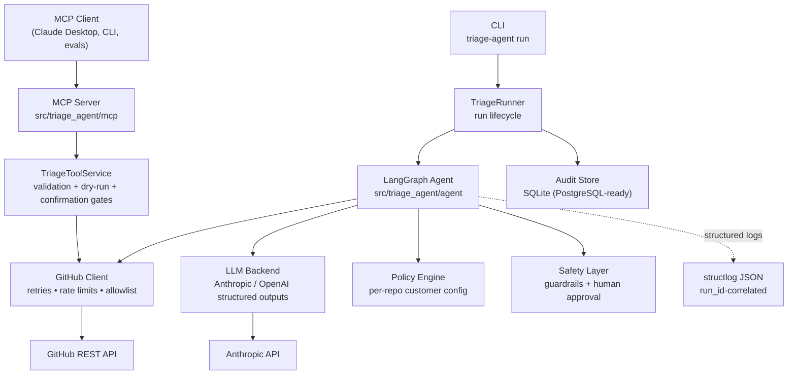
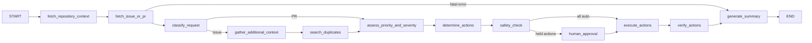
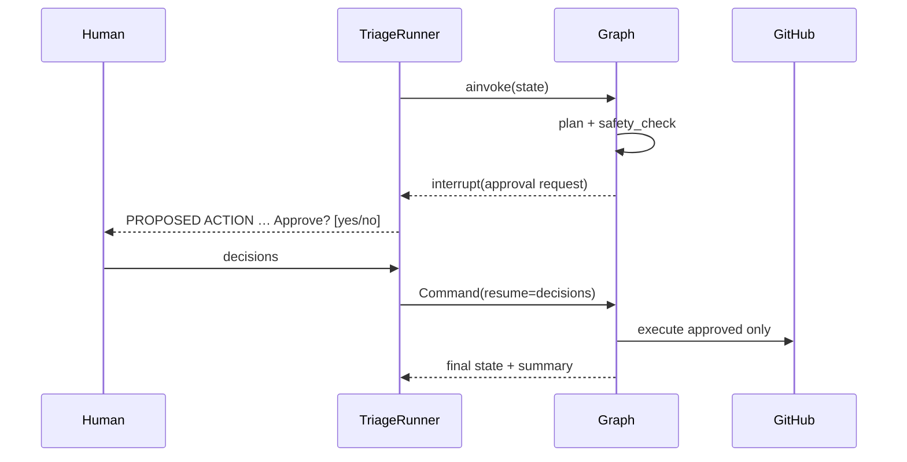

# Architecture

An autonomous GitHub issue/PR triage agent built as five cleanly separated
layers: an MCP surface, a LangGraph orchestration core, a GitHub integration
layer, a policy + safety stack, and persistence/observability underneath.

## High-level view

## Layers

### 1. MCP layer (`mcp/`)

`server.py` registers ten tools (eight required + `reopen_issue`,
`get_recent_repository_activity`) on an `MCPServer` and speaks stdio to any
MCP client. It is a *thin* wiring layer: every tool delegates to
`TriageToolService` (`tools.py`), which owns

- strict Pydantic input validation (owner/repo patterns, bounded lengths —
  the model can never reach arbitrary API paths),
- dry-run enforcement (`WOULD EXECUTE` responses, no network mutation),
- the two-step confirmation protocol for destructive tools: the first
  `close_issue`/`reopen_issue` call always returns a proposed action and
  performs nothing; only an explicit `confirm=true` — after a human has seen
  the proposal — executes.

Because the service is transport-agnostic, every safety property is unit
tested without an MCP transport in the loop.

### 2. GitHub integration layer (`github/`)

`client.py` is an async, typed wrapper over the REST v3 API with the
reliability features built in at the lowest level:

- exponential backoff with jitter (tenacity), honouring `Retry-After` /
  `X-RateLimit-Reset` on 429s,
- bounded retries, request timeouts, typed structured errors,
- retry metrics (`RetryMetrics`) surfaced to the audit trail,
- a repository allowlist checked on **every** call, and a
  `mutations_enabled=False` mode that hard-blocks writes below the policy
  layer (dry-run defence in depth).

`codeowners.py` implements CODEOWNERS parsing/matching
(last-match-wins, globs, users/teams/emails) so owner recommendations are
always grounded in the file — the model never invents usernames.

`models.py` keeps LLM-facing payloads thin and typed.

### 3. LangGraph orchestration (`agent/`)

The workflow is an explicit state graph over a fully typed Pydantic
`TriageState` — not one giant prompt:

Division of labour, deliberately:

- **LLM decides judgment calls** — classification, severity/priority,
  missing-information lists, duplicate comparison, comment wording — always
  through `messages.parse` structured outputs validated against Pydantic
  schemas. Critical decisions are never regex-parsed from prose.
- **Code decides everything enforceable** — deterministic PR signals
  (failing CI, diff size, test/doc file detection) override the model's echo
  of them; labels are filtered to the repository's real label set; duplicate
  verdicts may only reference retrieved candidates; the planner, policy
  engine and safety layer are pure logic.

Duplicate detection is hybrid: keyword search → lexical ranking
(`duplicates.py`) → LLM comparison of the top candidates → verdict
validation. Closing is only ever *proposed* above the configured threshold.

### 4. Policy engine + safety layer (`policies/`, `safety/`)

`policies/` holds the FDE-style customer configuration: per-repository
automation switches and priority→label mappings, resolved with a `default`
fallback. Different repositories get different behaviour with zero code
changes.

`safety/guardrails.py` gates each proposed action on four axes — risk class,
confidence thresholds, repository policy, and context (security-sensitive
items, bulk batches). Invariants:

- destructive actions **never** auto-run,
- below the review threshold nothing runs at all,
- guardrails can only approve or hold — rejection is a human decision,
- silence never approves (undecided actions default to rejected).

`human_approval` uses LangGraph's `interrupt()`: the run checkpoints, the
approval request (action, reason, evidence) is surfaced, and the graph
resumes with the human's decisions.

### 5. Persistence + observability (`persistence/`, `observability/`)

Every run writes an audit trail through the `AuditStore` protocol
(`agent_runs`, `agent_decisions`, `tool_executions`, `human_approvals`).
The shipped implementation is SQLite (aiosqlite); the protocol is the only
surface callers see, so a PostgreSQL implementation is a drop-in.

Logging is structlog JSON: every line carries the `run_id`, node, latencies
and retry counts, and a redaction processor scrubs token-shaped values so
secrets cannot reach a log sink. Each run ends with a traceable summary.

### 6. Evaluation system (`evals/` + `evals/scenarios/*.json`)

Scenarios script the two network edges (GitHub, LLM) and run the **real**
graph, planner, guardrails and executor. Each scenario declares expectations
(classification, required/forbidden proposals and executions, escalation),
and the runner aggregates task success, classification accuracy, label
correctness, duplicate precision/recall, unsafe-action rate, escalation
accuracy, tool reliability and latency. The full suite runs in CI as a
pytest gate — the unsafe-action rate must be exactly zero.

## Key design trade-offs

| Decision | Why |
|---|---|
| Deterministic planner consuming validated LLM assessments (vs. LLM tool-calling loop) | Auditable, testable, and the safety layer gates *actions*, not prose; the LLM cannot invent an action kind that doesn't exist |
| Confirmation as protocol (`confirm=true` re-call) on the MCP surface | Works with any MCP client today, no reliance on client-side elicitation support |
| Scripted-edge evals | Deterministic, fast, run in CI; measure the decision pipeline honestly and separately from live model quality |
| SQLite + protocol | Zero-dependency local start; PostgreSQL later without touching call sites |
| Own httpx GitHub client (vs. PyGithub) | Uniform async, tenacity retries, injectable transport for tests, and the allowlist/mutation gates live below every caller |
